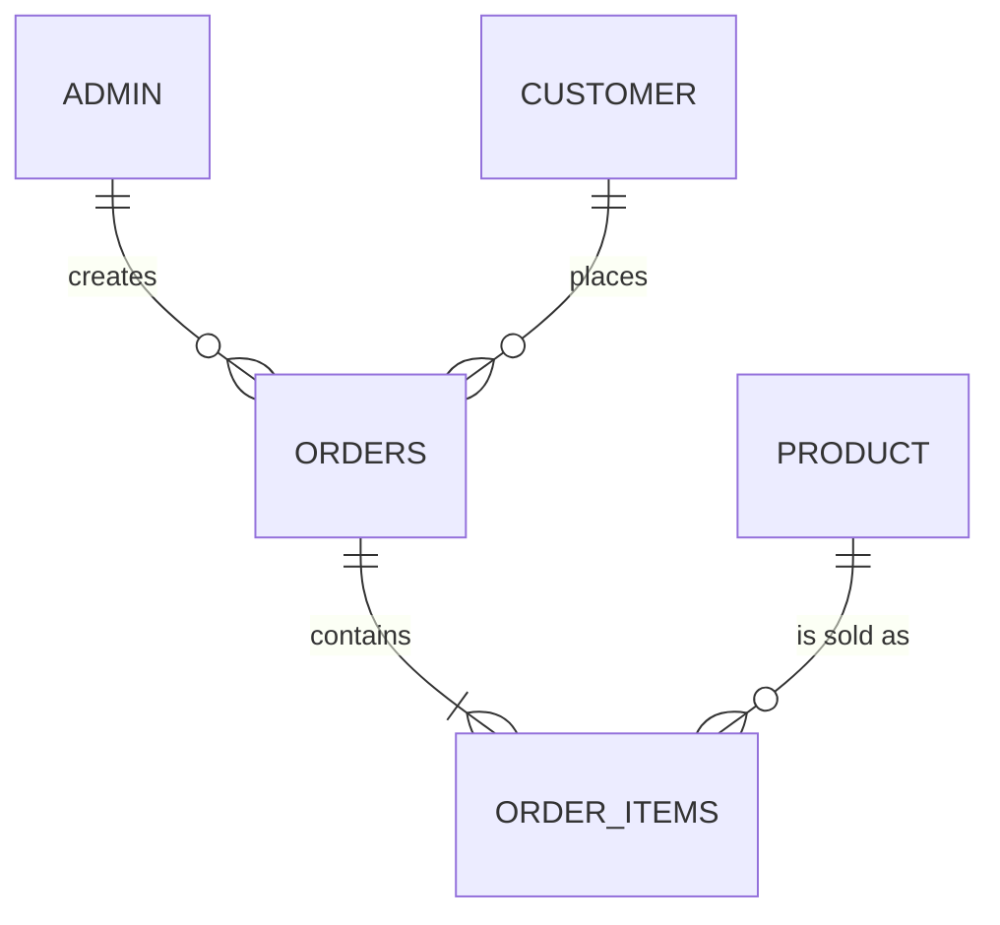

# E & E Banaging Chips: Sales Management System

A web-based sales record system for a banana chips business, built with **Flask (Python)**, **MySQL**, and plain **HTML / CSS / JavaScript**. Staff log in to manage products, customers and orders, and a live dashboard turns the sales records into KPIs, charts and a written summary. The same data is exported to Excel for cleaning, pivot analysis and an Excel dashboard.

> **Course project coverage:** Task 1 (Flask website), Task 2 (normalized MySQL database), Task 3 (real dataset), Task 4 (export and clean in Excel), Task 5 (Excel analysis), Task 6 (Excel dashboard). See the [task checklist](#task-checklist).

---

## Table of contents

1. [Features](#features)
2. [Tech stack](#tech-stack)
3. [Project structure](#project-structure)
4. [Requirements](#requirements)
5. [Installation](#installation)
6. [Running the system](#running-the-system)
7. [Database design](#database-design)
8. [Loading the real data](#loading-the-real-data)
9. [Pages and routes](#pages-and-routes)
10. [How the system works](#how-the-system-works)
11. [Dashboard in detail](#dashboard-in-detail)
12. [Security](#security)
13. [UI standards](#ui-standards)
14. [Excel work: Tasks 4, 5 and 6](#excel-work-tasks-4-5-and-6)
15. [Task checklist](#task-checklist)
16. [Resetting the database](#resetting-the-database)
17. [Troubleshooting](#troubleshooting)
18. [Extending the system](#extending-the-system)
19. [Deployment notes](#deployment-notes)
20. [Known limitations](#known-limitations)

---

## Features

**Accounts**
- Staff registration with password-strength meter and live "passwords match" check
- Login with a **Remember me** option (stays signed in for 30 days)
- Logout with a confirmation pop-up
- Passwords stored only as salted hashes

**Records (Products, Customers, Orders)**
- View in tables with **KPI cards** at the top of each page
- **Search**, filter, and **sort by any column** (server-side, so it works across pages)
- **Add**, **Edit** and **View** in pop-up modals, with errors shown inside the modal
- **Delete moves the record to an archive table** (and can be reviewed in a "Deleted" pop-up)
- Pagination (25 rows per page) for Customers and Orders
- New orders can hold several flavors, with a live total; prices always come from the database

**Dashboard**
- Title banner with "data as of" date
- Filters: date range (From / To), customer search, flavor, weekday, order status
- 4 KPI cards, 6 charts (monthly trend, revenue by flavor, flavor share, weekday sales, **daily sales for the last 30 days**, top 10 customers)
- A plain-language description under each chart that rewrites itself when filters change
- Auto-written **Summary Report**
- One-click **CSV export** of all sales

**Interface**
- Consistent gold and brown theme, Poppins font
- Toast notifications, accessible modals (keyboard and screen-reader friendly)
- Responsive down to phone width
- Sizes (buttons, inputs, charts) controlled from one file

---

## Tech stack

| Layer | Technology |
|---|---|
| Backend | Python 3.10+, Flask 3.0 |
| Database | MySQL 8.0.16+ (InnoDB) |
| DB driver | `mysql-connector-python` with a connection pool |
| Config | `python-dotenv` (`.env` file) |
| Templates | Jinja2 (server-rendered pages) |
| Frontend | HTML, CSS, vanilla JavaScript (no framework) |
| Charts | Chart.js 4.4.1 and chartjs-plugin-datalabels 2.2.0 (loaded from jsDelivr CDN) |
| Fonts | Poppins (Google Fonts) |
| Analysis | Microsoft Excel (pivot tables, slicers, dashboard) |

---

## Project structure

```
banaging-system/
├── app.py                    # Flask app: registers blueprints, dashboard page route
├── db.py                     # MySQL connection pool + query() / execute() helpers
├── test_db.py                # Quick database connection check
├── requirements.txt          # Python dependencies
├── .env                      # Secrets and DB settings (NEVER commit)
├── .gitignore
├── README.md
│
├── database/
│   ├── schema.sql            # All 7 tables, indexes and the app database user
│   └── load_data.sql         # Cleaned real data (customers, products, orders, items)
│
├── data/                     # (optional) Excel work files
│   ├── Banaging_Chips_-_Raw_Data.csv
│   ├── banaging_sales_YYYYMMDD.csv      # export from the system
│   └── Banaging_Cleaning.xlsx           # cleaning log, pivots, dashboard
│
├── routes/
│   ├── __init__.py           # (empty) marks the folder as a Python package
│   ├── auth.py               # register, login (remember me), logout, @login_required
│   ├── dashboard.py          # /dashboard/data JSON: filters, KPIs, charts, captions
│   ├── products.py           # products CRUD + archive
│   ├── customers.py          # customers CRUD + archive
│   ├── orders.py             # orders list, create (transaction), view, status
│   ├── export.py             # /export/sales.csv
│   └── helpers.py            # ok()/fail() JSON, paginate(), parse_day(), order_by()
│
├── templates/
│   ├── base.html             # Logged-in layout: top bar, toasts, logout dialog
│   ├── auth_base.html        # Login/register layout
│   ├── login.html
│   ├── register.html
│   ├── dashboard.html
│   ├── products.html
│   ├── customers.html
│   ├── orders.html
│   └── _ui.html              # Shared macros: stat, dialog, confirm_dialog, pager, sort_th
│
└── static/
    ├── css/
    │   ├── auth.css          # Login/register styling
    │   ├── style.css         # Base layout, buttons, tables, modals, toasts
    │   ├── dashboard.css     # Dashboard-only styling (filters, KPIs, chart cards)
    │   └── ui-standards.css  # Size tokens + table alignment/sorting (loads last)
    ├── js/
    │   ├── auth.js           # Password toggle, strength meter, submit state
    │   ├── app.js            # Toasts, modals, AJAX forms, table sorting (all logged-in pages)
    │   ├── dashboard.js      # Charts, filters, captions
    │   └── orders.js         # New-order rows, live total, View-order modal
    └── images/
        ├── auth_bg_wave.svg
        ├── favicon.ico
        └── logo.webp
```

---

## Requirements

| Software | Version | Notes |
|---|---|---|
| Python | 3.10 or newer | Tick "Add Python to PATH" during installation |
| MySQL Server | **8.0.16 or newer** | Older versions ignore `CHECK` constraints |
| MySQL Workbench | any recent | Optional, but the easiest way to run SQL files |
| A modern browser | Chrome, Edge, Firefox, Safari | Needs internet for the font and chart CDNs |
| VS Code | any | Recommended editor |
| Microsoft Excel | 2016+ (365 recommended) | For Tasks 4 to 6 |

---

## Installation

The commands below are for **Windows Command Prompt**. macOS/Linux equivalents are noted where they differ.

### 1. Get the project

Place the project in a folder, then open a terminal there:

```bat
cd "C:\path\to\banaging-system"
```

Quote the path if it contains spaces.

### 2. Create and activate a virtual environment

```bat
python -m venv venv
venv\Scripts\activate
```

macOS/Linux: `source venv/bin/activate`. You should see `(venv)` at the start of your prompt.

### 3. Install dependencies

```bat
pip install -r requirements.txt
```

If `requirements.txt` is empty, install directly and regenerate it:

```bat
pip install Flask==3.0.3 mysql-connector-python==9.0.0 python-dotenv==1.0.1
pip freeze > requirements.txt
```

### 4. Create the database

Make sure the MySQL service is running (`Win + R` > `services.msc` > **MySQL80** > Running).

Open `database/schema.sql` and **change the app user's password** to your own. Then run it as root:

```bat
mysql -u root -p < database\schema.sql
```

(Use Command Prompt, not PowerShell, because `<` doesn't work in PowerShell. If `mysql` isn't recognized, use the full path, for example `"C:\Program Files\MySQL\MySQL Server 8.0\bin\mysql.exe"`.)

Or open the file in **MySQL Workbench** (File > Open SQL Script) and click the lightning bolt.

Verify:

```sql
USE banaging_db;
SHOW TABLES;
```

You should see 7 tables: `admin`, `customer`, `deleted_customers`, `deleted_products`, `order_items`, `orders`, `product`.

### 5. Configure `.env`

Create a file named exactly `.env` in the project root (same folder as `app.py`):

```
DB_HOST=localhost
DB_PORT=3306
DB_USER=banaging_user
DB_PASSWORD=the_password_you_set_in_schema.sql
DB_NAME=banaging_db
SECRET_KEY=paste_a_long_random_string_here
```

Generate the secret key:

```bat
python -c "import secrets; print(secrets.token_hex(32))"
```

Rules: no quotes, no spaces around `=`, and the file must not be called `.env.txt`. `DB_PORT` is only needed if your MySQL doesn't use 3306 (XAMPP sometimes uses 3307).

> **Never commit `.env`.** It is listed in `.gitignore`. Keep the same `SECRET_KEY` between runs, otherwise everyone gets logged out.

### 6. Test the connection

```bat
python test_db.py
```

Expected output:

```
Connected to: banaging_db
Tables: ['admin', 'customer', 'deleted_customers', 'deleted_products', 'order_items', 'orders', 'product']
```

### 7. Create your first account

Start the app (next section), open `/register`, and create a staff account. This must be done **before** loading the real data, because every order needs an admin who created it.

---

## Running the system

Every time you want to use it:

```bat
cd "C:\path\to\banaging-system"
venv\Scripts\activate
python app.py
```

Then open **http://127.0.0.1:5000**. Keep the terminal open while using the site, and press `Ctrl + C` to stop it.

Before running, make sure MySQL is started.

---

## Database design

### Entity relationship diagram



Two extra tables, `deleted_products` and `deleted_customers`, are standalone archives with no foreign keys.

### Tables

| Table | Purpose | Key columns |
|---|---|---|
| `admin` | Staff accounts | `admin_id` (PK), `username` (unique), `password` (hash), `fullname`, `created_at`, `updated_at` |
| `customer` | Buyers | `customer_id` (PK), `customer_name`, `city`, `phone`, `created_at` |
| `product` | Flavors | `product_id` (PK), `flavor` (unique), `category`, `price`, `is_active` |
| `orders` | One row per order | `order_id` (PK), `admin_id` (FK), `customer_id` (FK), `order_date`, `status` |
| `order_items` | Flavors inside an order | `order_item_id` (PK), `order_id` (FK), `product_id` (FK), `quantity`, `unit_price` |
| `deleted_products` | Archive of deleted products | `deleted_id` (PK), original `product_id`, `deleted_by`, `deleted_at` |
| `deleted_customers` | Archive of deleted customers | `deleted_id` (PK), original `customer_id`, `deleted_by`, `deleted_at` |

### Data types and rules

| Column | Type | Rule |
|---|---|---|
| Money (`price`, `unit_price`) | `DECIMAL(10,2)` | Never FLOAT. Cannot be negative (`CHECK`) |
| `quantity` | `INT UNSIGNED` | Must be greater than 0 (`CHECK`) |
| `status` | `ENUM('pending','paid','completed','cancelled')` | Prevents typos such as "Pendng" |
| `password` | `VARCHAR(255)` | Holds a long hash, so a short column would truncate it |
| `order_date`, timestamps | `DATETIME` | `created_at` and `updated_at` fill themselves in |
| `is_active` | `BOOLEAN` | Retire a flavor without deleting its history |

### Foreign key behavior

| Relationship | On delete | Why |
|---|---|---|
| `orders.admin_id` > `admin` | RESTRICT | You can't delete an admin who has orders |
| `orders.customer_id` > `customer` | RESTRICT | Protects sales history |
| `order_items.order_id` > `orders` | CASCADE | Deleting an order removes its lines |
| `order_items.product_id` > `product` | RESTRICT | A flavor that was sold can't be erased. Mark it inactive instead |

Other rules:
- `UNIQUE (order_id, product_id)`: a flavor appears once per order. Quantities are combined instead.
- `unit_price` is copied into each order line, so changing a product's price later **never changes old orders**.
- Order totals are **calculated** (`SUM(quantity * unit_price)`), never stored, so they cannot go out of sync.
- Indexes on `orders.order_date` and `orders.status` speed up the dashboard filters.

### Normalization

The design is in third normal form: each fact is stored once (customer details in `customer`, prices in `product`), orders are split into a header and lines, and every non-key column depends on its table's key.

### Delete = move to archive

When a product or customer is deleted, the row is copied into its archive table and then removed, **inside one transaction**, so either both steps happen or neither does. If the record is used by an order, the foreign key blocks the delete, the copy is rolled back, and the user sees a clear message ("mark the product inactive instead").

---

## Loading the real data

The real sales data came from `Banaging_Chips_-_Raw_Data.csv` (1,281 rows, Dec 2025 to Aug 2026). `database/load_data.sql` loads a cleaned version.

**Run it (after registering an admin):**

```bat
mysql -u root -p < database\load_data.sql
```

or open it in Workbench and execute. It empties the tables (except `admin`) and then inserts everything.

### Cleaning rules applied

| Raw value | Cleaned to |
|---|---|
| `Sugar`, `O`, `Orig`, `Original`, `Original/Sugar` (any capitalization) | **Original** |
| `bbq`, `Bbq`, `BBQ` | **BBQ** |
| `SC`, `Sour Cream` | **Sour Cream** |
| `C`, `Cheese`, `Chesse` (typo) | **Cheese** |
| Names with different capitalization or stray spaces (`hazel`, `Hazel`, `Chris `) | One customer each, in proper case (initials like MG, RK, KC, MJ stay uppercase) |
| Dates such as `12/4/2025` | `2025-12-04` |
| One row with a blank name | Saved as `Unknown Customer` |

### Mapping from the CSV to tables

| Table | Rows | Rule |
|---|---|---|
| `product` | 4 | The four cleaned flavors, all PHP 45.00, category `Chips` |
| `customer` | 710 | One per unique cleaned name |
| `orders` | 1,047 | **One order per customer per day** (the CSV has no order numbers). All set to `completed` |
| `order_items` | 1,278 | Three CSV rows merged because the same customer bought the same flavor twice on one day |

### Checksums (use these to confirm the load worked)

| Check | Expected |
|---|---|
| Total quantity | **1,654** bags |
| Total sales | **PHP 74,430.00** |
| Date range | 2025-12-04 to 2026-08-31 |
| Transactions (order lines) | **1,278** (the raw CSV had 1,281) |

```sql
SELECT SUM(quantity) AS bags, SUM(quantity * unit_price) AS sales FROM order_items;
```

---

## Pages and routes

### Pages (HTML)

| URL | Page | Login needed |
|---|---|---|
| `/login` | Login | No |
| `/register` | Create staff account | No |
| `/logout` | Logs out (a confirmation pop-up appears first) | Yes |
| `/` | Dashboard | Yes |
| `/products/` | Products table | Yes |
| `/customers/` | Customers table | Yes |
| `/orders/` | Orders table | Yes |

### Actions (return JSON, used by the pop-up forms)

| Method and URL | Action |
|---|---|
| `POST /products/add` | Add a product |
| `POST /products/<id>/edit` | Edit a product |
| `POST /products/<id>/delete` | Move a product to the archive |
| `POST /customers/add` | Add a customer |
| `POST /customers/<id>/edit` | Edit a customer |
| `POST /customers/<id>/delete` | Move a customer to the archive |
| `POST /orders/add` | Create an order with its items |
| `GET /orders/<id>` | Order details (for the View pop-up) |
| `POST /orders/<id>/status` | Change an order's status |

Responses look like `{"ok": true, "message": "..."}` or `{"ok": false, "error": "..."}` with an HTTP error code.

### Data endpoints

| URL | Returns |
|---|---|
| `GET /dashboard/data` | All dashboard numbers as JSON |
| `GET /export/sales.csv` | Flat CSV of every sold item (UTF-8 with BOM, so Excel reads accents correctly) |

### URL parameters

| Parameter | Used on | Meaning |
|---|---|---|
| `q` | Products, Customers, Orders | Search text |
| `status` | Products (`active` / `inactive`), Orders (order status) | Filter |
| `from`, `to` | Orders, Dashboard | Date range (`YYYY-MM-DD`) |
| `sort`, `dir` | Products, Customers, Orders | Column key and `asc` / `desc` |
| `page` | Customers, Orders | Page number (25 rows per page) |
| `flavors`, `weekdays`, `statuses`, `customer` | Dashboard | Dashboard filters (weekdays are 0 = Monday to 6 = Sunday) |

---

## How the system works

```
Browser ──request──> Flask route ──SQL via db.py──> MySQL
   ^                      |                            |
   └──── HTML or JSON <───┴──────── rows ──────────────┘
```

**Server-rendered pages:** a route runs queries, passes the results to a Jinja template, and returns HTML. Page layouts live in `base.html` and `_ui.html` macros, so each page only writes its own content.

**Pop-up forms:** a button with `data-open="someDialog"` opens a `<dialog>`. Forms marked `data-ajax` are sent with `fetch`. On success the page reloads and a toast appears. On failure the error shows inside the modal, so the user doesn't lose their input.

**Sorting:** header links carry `?sort=column&dir=asc`. The route maps the column name to a SQL expression through a fixed list (`order_by()` in `helpers.py`), so nothing typed in the URL reaches the SQL. The small "Deleted" tables sort instantly in the browser.

**Database access:** `db.py` keeps a pool of 5 connections and exposes two helpers:

```python
query(sql, params=(), one=False)   # SELECT: list of dicts, or one dict/None
execute(sql, params=())            # INSERT/UPDATE/DELETE: commits, returns last id
```

**Creating an order** (`routes/orders.py`) validates input first, then runs one transaction: check the customer, read prices from `product`, insert into `orders`, insert into `order_items`, commit. Any failure rolls everything back, so there are never half-saved orders.

---

## Dashboard in detail

### Filters

Set the filters, then press **Search** (or Enter). Press **Reset** to clear everything. Filters combine with each other.

| Filter | Behavior |
|---|---|
| From / To | Either or both. The "To" day is included completely |
| Customer | Type and pick a suggestion |
| Flavor | Any number of flavors |
| Weekday | Mon to Sun |
| Status | With none selected, cancelled orders are hidden. Pick "Cancelled" to see them |

A summary line under the bar states what is applied, and the Filters button shows a count badge.

### KPI cards

| Card | Meaning |
|---|---|
| Total revenue | Sum of `quantity * unit_price`, and its share of all-time revenue |
| Units sold | Total bags, and average bags per transaction |
| Transactions | Number of order lines in the selection |
| Avg per transaction | Revenue divided by transactions, plus the top flavor |

### Charts

| Chart | Notes |
|---|---|
| Monthly Revenue Trend | Reacts to all filters |
| Revenue by Flavor | Colors match the flavors |
| Flavor Share | Percentages inside the doughnut |
| Sales by Weekday | Always shows Mon to Sun, so Saturday appears as 0 |
| **Daily Sales (Last 30 Days)** | The 30-day window ends on the **To** date, or on the **latest sale** in the current view. Days with no sales show as 0. With the current data it covers Aug 2 to Aug 31, 2026 |
| Top 10 Customers (all time) | Ignores every filter |

Each chart has a plain-language description generated by the server, and a **Summary Report** at the bottom of the page.

### Expected values (full dataset, no filters)

| Item | Value |
|---|---|
| Revenue / bags / transactions | PHP 74,430 / 1,654 / 1,278 |
| Average per transaction | PHP 58.24 |
| Flavors | Sour Cream 25,020 (34%), BBQ 19,665 (26%), Cheese 17,685 (24%), Original 12,060 (16%) |
| Weekdays | Mon 14,265, Tue 15,300, Wed 13,860, Thu 15,570, Fri 15,255, Sat 0, Sun 180 |
| Months | Dec 10,620, Jan 11,925, Feb 11,115, Mar 6,525, Apr 4,815, May 4,950, Jun 8,550, Jul 8,460, Aug 7,470 |
| Top customers | Angela 585, Bea 540, Justine 495, Manami 450, RK 405 |
| Last 30 days | PHP 7,470 over 21 active days, best day Aug 28 (PHP 675) |

Table pages show: 4 products, 710 customers, 1,047 orders. The largest order is PHP 270 (Sir, Feb 10, 2026).

---

## Security

| Concern | How it is handled |
|---|---|
| Passwords | Hashed with Werkzeug (`generate_password_hash`) and checked with `check_password_hash`. Plain text is never stored |
| SQL injection | Every value goes through `%s` placeholders. Dynamic parts of a query (sort columns, `IN (...)` lists) are built only from fixed whitelists or the text `%s` |
| Cross-site scripting | Jinja auto-escapes output, and JavaScript writes with `textContent` |
| Access control | `@login_required` on every page and endpoint except login and register |
| Sessions | Signed cookie (needs `SECRET_KEY`), `HttpOnly`. "Remember me" lasts 30 days, otherwise it ends when the browser closes |
| Pricing | The browser never sends prices. The server reads them from `product` |
| Data integrity | Foreign keys, `CHECK` rules, a `UNIQUE` order-item rule, and transactions |
| Database account | The app connects as `banaging_user`, which has only SELECT, INSERT, UPDATE and DELETE on one database, never root |
| Login errors | Deliberately vague ("Invalid username or password") so attackers can't tell which usernames exist |
| Secrets | `.env` is ignored by git. Don't commit `schema.sql` with a real password in it |

---

## UI standards

All sizes come from `static/css/ui-standards.css`, so changing one variable updates every page.

| Element | Standard |
|---|---|
| Spacing | 4, 8, 12, 16, 24, 32 px steps (8-point grid) |
| Buttons and inputs | 40 px tall on desktop, 44 px on touch screens |
| Small buttons | 32 px (40 px on touch) |
| Button minimum width | 88 px (64 px for small) |
| Filter chips | 36 px (44 px on touch) |
| Input text | 14 px, and 16 px on touch devices so iOS doesn't zoom |
| Corner radius | 8 px controls, 12 px cards, 16 px modals |
| Charts | 360 px tall, Top 10 chart 440 px, 300 px on phones |
| Table values | Left-aligned in every column |
| Focus | Visible 3 px focus ring on every control |
| Motion | Disabled for users who prefer reduced motion |

**Palette:** gold `#FFC322`, dark brown `#3B2A14`, tan `#D9C48A`, accents red `#C0392B`, green `#6AA84F`, brown `#B08968`.

---

## Excel work: Tasks 4, 5 and 6

### Task 4: Export and clean

1. Log in, click **Download CSV** on the dashboard. A file `banaging_sales_YYYYMMDD.csv` is created.
2. In Excel: **Data > From Text/CSV**, set the file origin to **65001: Unicode (UTF-8)**, then Load.
3. Save as `Banaging_Cleaning.xlsx`. Keep an untouched `Raw` sheet, work on a copy called `Clean`, and format the data as a Table named `tblSales`.
4. Apply each technique and record it in a `Cleaning Log` sheet (technique, tool, issues found, action):

| Technique | Excel tool |
|---|---|
| Remove duplicates | Data > Remove Duplicates (leave `order_id` unticked) |
| Capitalization | `PROPER()`, then restore initials like MG and BBQ |
| Unnecessary spaces | `TRIM()` or `TRIM(CLEAN())` |
| Standardize dates | Format Cells > `yyyy-mm-dd`, check with `ISNUMBER()` |
| Missing values | Go To Special > Blanks, then fill |
| Invalid entries | Filter dropdown lists, Data Validation list (`Original,BBQ,Sour Cream,Cheese`) |
| Validate numbers | A check column: `=AND(ISNUMBER([@quantity]),[@quantity]>0,...)`, plus data validation |

Because the data was already cleaned in SQL, the database export finds few issues. For stronger evidence, run the same steps on the **raw CSV**, which contains real problems (case variants, trailing spaces, `Orig` and `Chesse`, a blank name, text dates).

**Checkpoint after cleaning:** 1,278 rows, quantity sum 1,654, total_price sum 74,430, 4 distinct flavors.

### Task 5: Analysis

| Tool | What was built |
|---|---|
| Pivot tables | By flavor, month, weekday, and top customers |
| Pivot charts | Doughnut, line, column and bar charts |
| Sorting | Single, multi-level and custom-list sorts |
| Filtering | Text, date, number and search filters, with `SUBTOTAL(109, ...)` |
| Conditional formatting | Data bars, color scales, icon sets, top/bottom rules, formula rule |
| Descriptive statistics | On daily sales: mean 387.66, median 360, std dev 209.29, min 90, max 1,440 (192 days) |
| Summary tables | `SUMIFS` flavor summary and a flavor-by-month cross-tab |

### Task 6: Excel dashboard

- **KPI cards:** Total revenue, units sold, transactions, average per transaction (`GETPIVOTDATA`)
- **Slicers:** Month and Flavor, connected to every pivot through **Report Connections**
- **Charts:** monthly revenue trend, revenue by flavor, flavor share, sales by weekday, top 10 customers
- **Dynamic chart:** reacts to slicers, plus a dropdown-driven chart
- **Summary report:** sentences built from formulas

The web dashboard is the live version of this Excel dashboard.

---

## Task checklist

| Task | Requirement | Where it is |
|---|---|---|
| 1 | Flask website: login, registration, dashboard, add, edit, delete (moves to another table), search, view | The whole web app. Delete moves rows to `deleted_products` and `deleted_customers` |
| 2 | Normalized database, 3+ related tables, PK, FK, appropriate types, 100+ records | `database/schema.sql` (5 core tables plus 2 archives), `load_data.sql` (1,278 order lines) |
| 3 | Meaningful dataset | Real banana chip sales, Dec 2025 to Aug 2026 |
| 4 | Export and clean in Excel | `/export/sales.csv`, `Banaging_Cleaning.xlsx`, Cleaning Log |
| 5 | Pivots, pivot charts, sorting, filtering, conditional formatting, statistics, summary tables | Excel workbook |
| 6 | Dashboard: 4+ charts, 3+ KPI cards, 2 slicers, dynamic charts, summary report | Excel workbook (and the web dashboard) |

---

## Resetting the database

**Empty the data but keep the structure** (run as root in Workbench):

```sql
USE banaging_db;
SET FOREIGN_KEY_CHECKS = 0;
TRUNCATE TABLE order_items;
TRUNCATE TABLE orders;
TRUNCATE TABLE deleted_products;
TRUNCATE TABLE deleted_customers;
TRUNCATE TABLE product;
TRUNCATE TABLE customer;
-- TRUNCATE TABLE admin;   -- only if you also want to delete the staff accounts
SET FOREIGN_KEY_CHECKS = 1;
```

`TRUNCATE` also resets the ID counters to 1. If you truncate `admin`, register a new account afterwards.

**Rebuild everything:**

```sql
DROP DATABASE IF EXISTS banaging_db;
DROP USER IF EXISTS 'banaging_user'@'localhost';
```

Then run `schema.sql` again. Neither option can be undone, so export a backup first if the data matters (Workbench > Server > Data Export).

---

## Troubleshooting

**Read the last line of the traceback in the terminal first.** It names the real error, and the lines above it point to the file and line. With `debug=True` the browser also shows the traceback.

### Start-up and database

| Symptom | Cause and fix |
|---|---|
| `Access denied for user 'banaging_user'` | `.env` password doesn't match MySQL. Reset with `ALTER USER 'banaging_user'@'localhost' IDENTIFIED BY 'new';` and update `.env` |
| `Can't connect to MySQL server` | MySQL isn't running. Start the service. Check `DB_PORT` |
| `Unknown database` | `schema.sql` wasn't run, or `DB_NAME` is wrong |
| `Unknown column 'category'` / `'city'` | You are using an older schema. Re-run the current `schema.sql` |
| `Table '...deleted_products' doesn't exist` | Same as above, the archive tables are missing |
| `ModuleNotFoundError` | The virtual environment isn't active (`venv\Scripts\activate`) or packages aren't installed |
| `ModuleNotFoundError: routes` | `routes/__init__.py` is missing, or you started Flask from the wrong folder |
| `'python' is not recognized` | Python isn't in PATH. Try `py app.py` |
| `Address already in use` | An old Flask is still running. Close it with `Ctrl + C` |
| `.env` values are `None` | The file is misnamed (`.env.txt`), in the wrong folder, or has typos in variable names |

### Login and sessions

| Symptom | Cause and fix |
|---|---|
| Login works but bounces back to login | `SECRET_KEY` is empty in `.env` |
| Logged out after every restart | `SECRET_KEY` changes between runs. Keep a fixed value |
| Creating an order fails with a foreign key error | Your session points to an admin that was deleted (after truncating `admin`). Log out and register or log in again |
| Remember me doesn't persist | Same `SECRET_KEY` issue, or the browser blocks cookies |

### Pages and templates

| Symptom | Cause and fix |
|---|---|
| `TemplateNotFound` | The file is missing from `templates/` or misspelled |
| `BuildError: Could not build url for endpoint` | The blueprint isn't registered in `app.py`. Endpoint names look like `blueprint.function`, for example `auth.login` |
| `UndefinedError ... sort_key` | The route's `render_template` doesn't pass `sort_key` and `sort_dir` |
| `TemplateAssertionError ... sort_th` | The `` line is missing the macro |
| Page unstyled or looks old | Cached CSS. Hard-refresh with `Ctrl + Shift + R` |
| A pop-up button does nothing | `app.js` isn't loading. Press F12 and look in the Console |

### Dashboard

| Symptom | Cause and fix |
|---|---|
| "Could not load the dashboard data (Server returned 500)" | Open `http://127.0.0.1:5000/dashboard/data` while logged in to see the traceback, or read the terminal |
| SQL syntax error near `lines` | `LINES` is a reserved word in MySQL. The code uses the alias `tx` instead |
| "The charts could not load" | The Chart.js CDN is blocked or you are offline. See the offline option below |
| Every number is 0 | The database is empty. Run `load_data.sql` |
| Daily chart looks empty | The filters exclude the last 30 days. Press Reset |
| Customer filter does nothing | Pick the name from the suggestion list. Typing it by hand isn't enough |

**Offline option for demos:** download the two CDN scripts listed in `dashboard.html` while online, save them in `static/js/`, and point the `<script src>` tags at them with `url_for('static', ...)`.

### Tables

| Symptom | Cause and fix |
|---|---|
| `OperationalError ... isn't in GROUP BY` | A selected column is missing from `GROUP BY`. Add it |
| Delete is refused | By design: the record is used by an order. Mark a product inactive instead |
| Totals show `0.00` for an order with items | Check the join with a real `order_id` in Workbench |
| Sorting resets when searching | The search form is missing its hidden `sort` and `dir` inputs |

### Debugging habits

1. Read the traceback bottom-up.
2. If SQL looks wrong, copy it into Workbench with real values and run it there. If it fails there too, the bug is in the SQL, not in Python.
3. To see what the browser sent, add `print(request.form)` or `print(request.args)` at the top of a route and look in the terminal. Remove it afterwards.
4. For front-end problems, press F12: the **Console** shows JavaScript errors and the **Network** tab shows failed requests and their responses.

---

## Extending the system

To add a new record type (for example, suppliers):

1. **Table:** add it to `schema.sql` and run the `CREATE TABLE` in MySQL.
2. **Route:** create `routes/suppliers.py` with a blueprint, a list page (use `paginate()` and `order_by()`), and JSON add/edit/delete actions (use `ok()` and `fail()`).
3. **Register:** import the blueprint in `app.py` and call `app.register_blueprint(...)`.
4. **Template:** create `templates/suppliers.html` using the macros in `_ui.html` (`stat`, `dialog`, `confirm_dialog`, `pager`, `sort_th`).
5. **Navigation:** add the link in `base.html`.

Conventions to keep:
- Always pass values through `%s` placeholders.
- Validate input before touching the database, and use a transaction when writing to more than one table.
- Use `ok()` for success so the user sees a green toast, and `fail()` for errors shown in the modal.
- Put colors and sizes in the CSS variables, not inside individual rules.

---

## Deployment notes

The built-in server (`python app.py`) is for development only. Before putting the system on a real server:

- Set `debug=False` in `app.py` (or remove `debug=True`).
- Serve it with a production server: **Waitress** on Windows (`waitress-serve --port=8000 app:app`) or **Gunicorn** behind Nginx on Linux.
- Use **HTTPS**, and add `SESSION_COOKIE_SECURE=True` to the app config.
- Keep secrets in environment variables or a protected `.env`, and use a strong `SECRET_KEY`.
- Use a strong database password and restrict MySQL access to the app server.
- Schedule regular database backups.

---

## Known limitations

- Orders can be created and their status changed, but not edited or deleted yet.
- Login has no password reset and no rate limiting after repeated failed attempts.
- Logout is a simple link (`GET /logout`) with a confirmation pop-up. A POST-only logout would be stricter.
- The customer table holds only a name, city and phone. Email and address fields would need new columns and form changes.
- The historical load created one order per customer per day, because the source file had no order numbers.
- Charts and fonts load from CDNs, so the dashboard needs internet access unless you host the files locally.
- The Excel dashboard is separate from the web dashboard, and Excel pivots need **Data > Refresh All** after the data changes.

---

## Credits

Built as a course project for the Python (Flask), MySQL and Excel data analysis requirements.

- **Project:** E & E Banaging Chips Sales Management System
- **Author:** _Your name here_
- **Course / Instructor:** _Fill in_